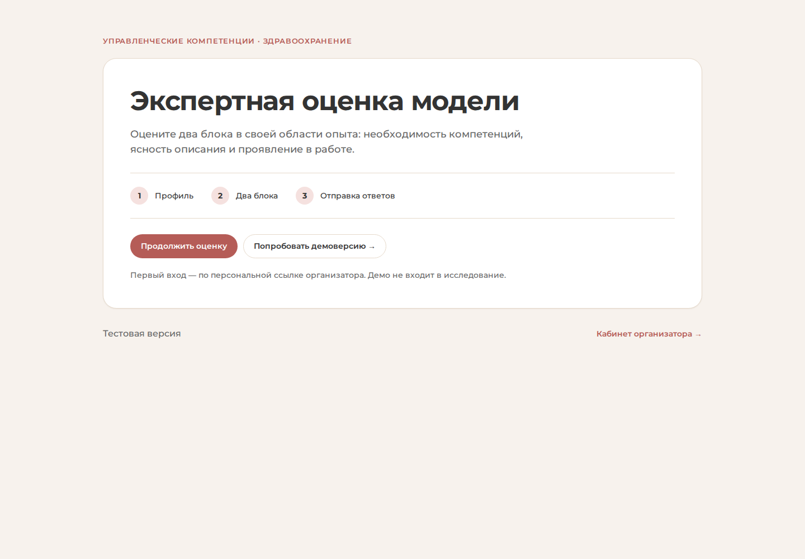
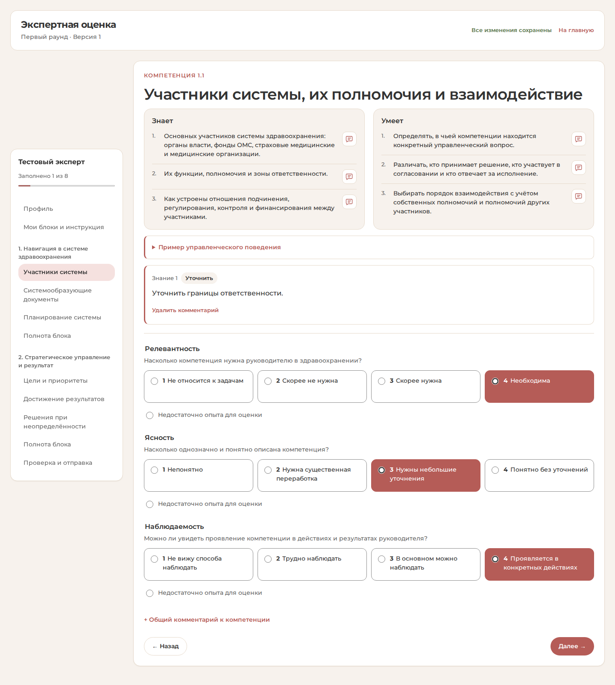
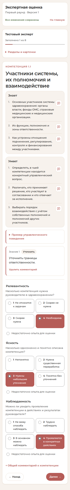

# Экспертная оценка — Mednet Kit

Обновление интерфейса от 27 октября 2026 года в отдельной ветке `codex/mednet-kit-ui`.
Основной сайт продолжает работать на прежней версии. Все данные на скриншотах вымышленные.

Подключены настоящие пакеты Mednet Kit: семантические токены и локальные шрифты Montserrat.
Обновлены главная, вход, профиль, карточки оценки, повторный раунд, приоритеты и кабинет организатора.
Механика оценки, персональные ссылки, предзаполнение и сохранение ответов сохранены.

## Главная

## Карточка оценки

## Мобильная версия

## Проверки

- `npm run check`: синтаксис JavaScript, семантические токены и наличие локальных файлов шрифтов.
- Полный браузерный сценарий на временной базе: приглашение, предзаполнение и коррекция профиля,
  копирование ссылки, восемь карточек двух блоков, комментарий, перезагрузка,
  второй раунд, BWM, результаты организатора; ширины 320 и 390 px.
- Ошибок JavaScript и ответов сервера 5xx в сценарии нет.

Документация: https://mednet-kit-doc.vercel.app/docs/static
